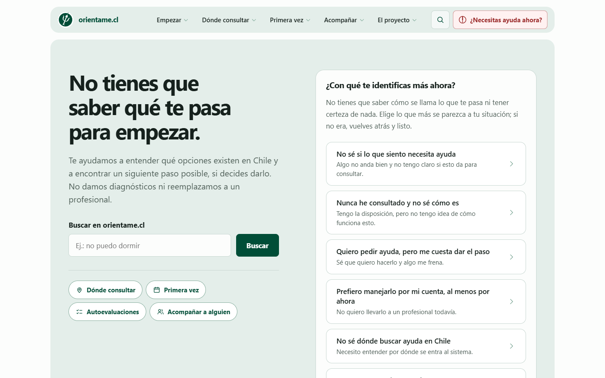
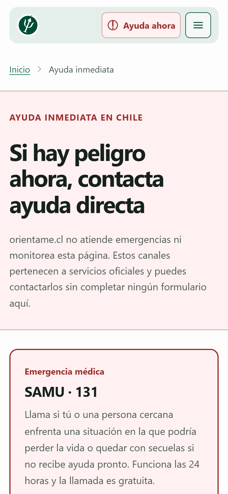
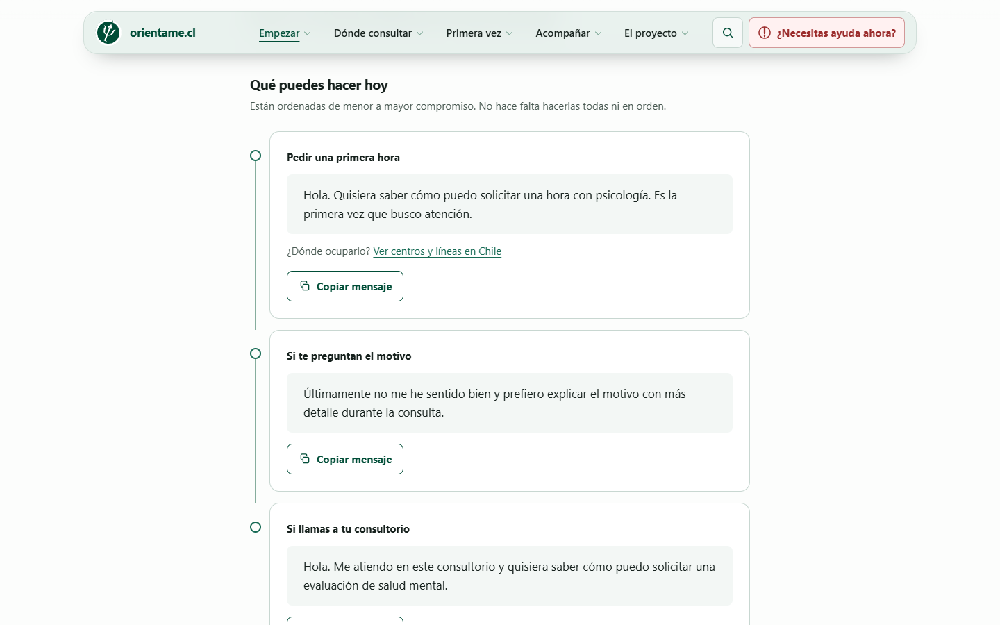
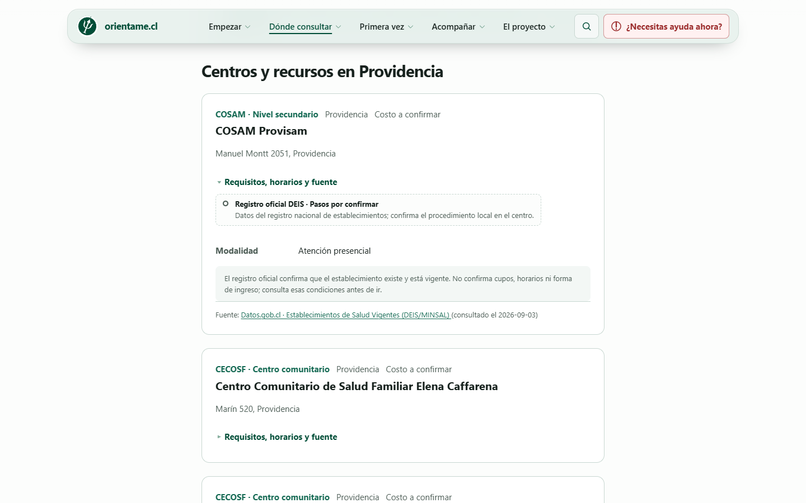

# orientame.cl

<p align="center">
  
</p>

<p align="center">
  <strong>Sitio en línea: <a href="https://orientame.cl">orientame.cl</a></strong>
</p>

<p align="center">
  <a href="https://github.com/john-Mcan/orientame.cl/actions/workflows/ci.yml"></a>
  <a href="LICENSE.md"></a>
</p>

**orientame.cl** es una plataforma digital, estática y sin fines de lucro orientada inicialmente a
Chile. Busca ayudar a una persona a entender sus opciones de salud mental y facilitar un siguiente
paso posible, si decide darlo.

Ese paso puede ser informarse, conocer cómo funciona una primera atención, preparar qué decir,
encontrar una alternativa pública o de bajo costo, usar una autoevaluación orientativa o detenerse y
volver después.

> [!IMPORTANT]
> orientame.cl no presta atención psicológica, no diagnostica, no reemplaza una evaluación o un
> tratamiento profesional y no es un servicio de crisis. La información de urgencia se ofrece como
> un acceso directo que la persona elige, no como una conclusión automática del sistema.

<p align="center">
  
  
</p>

## Estado del proyecto

La v1 está publicada en [orientame.cl](https://orientame.cl) desde septiembre de 2026. Incluye:

- un orientador de primer paso basado en rutas estáticas, con una puerta de entrada por cada barrera
  que describe el documento base;
- contenido para entrar por una vivencia cotidiana o por un tema de salud mental;
- guías sobre una primera atención y sobre cómo acompañar a otra persona;
- búsqueda estática;
- tres autoevaluaciones (OMS-5, GAD-7 y PHQ-8) que se procesan en el navegador;
- un piloto de recursos de atención en tres comunas de la Región Metropolitana, con establecimientos
  del registro oficial DEIS/MINSAL;
- acceso persistente a información de urgencia, utilizable sin JavaScript;
- páginas públicas de metodología, alcance, privacidad y términos.

| Una guía del orientador                                                                                                                                              | Fichas de una comuna en `/donde`                                                                                                            |
| -------------------------------------------------------------------------------------------------------------------------------------------------------------------- | ------------------------------------------------------------------------------------------------------------------------------------------- |
|  |  |

Sigue abierto:

- **`/donde` a escala nacional.** Hoy la página índice incluye todas las fichas; antes de cargar más
  comunas hay que dejar las fichas sólo en la página de cada comuna.
- **Protocolo de crisis.** Está publicado como borrador para revisión profesional, no está aprobado
  y no activa ninguna lógica de respuesta.
- **Testimonios.** `/historias` no existe y no se publicará sin consentimiento y procedencia
  documentados.
- **Correcciones editoriales** ya identificadas en `/siento` y `/temas`, y huecos de trazabilidad
  conocidos.
- **Etapa 5:** modo oscuro, cierre de WCAG 2.2 AA y pruebas de extremo a extremo.
- **Revisión legal:** Ley 21.719 de datos personales, Ley 21.331 de salud mental y licencias de los
  instrumentos.

Qué falta en cada punto, por qué quedó pendiente y qué habría que hacer está en
[`docs/pendientes.md`](docs/pendientes.md).

## Principios del producto

- **No diagnosticamos.** El contenido explica opciones sin concluir qué tiene o qué necesita una
  persona.
- **La persona conserva la decisión.** No se presiona, culpa ni persuade mediante miedo.
- **Siempre existe un paso de menor compromiso.** Detenerse y volver después también es una opción
  válida.
- **Privacidad por arquitectura.** No hay cuentas, base de datos de usuarios ni almacenamiento en
  servidores de las respuestas entregadas en las herramientas.
- **La crisis no se delega a IA.** No hay chatbot de crisis, evaluación automática de riesgo ni
  decisiones generativas.
- **Las afirmaciones sensibles son trazables.** El conocimiento general de un modelo de IA no es una
  fuente publicable.
- **Sin incentivos ocultos.** Los recursos no se ordenan por pago y no existen comisiones por
  derivación.
- **Accesibilidad desde el diseño.** El objetivo mínimo es WCAG 2.2 AA.

La fuente de verdad sobre propósito, alcance, seguridad, privacidad y gobernanza editorial es el
[`documento base de producto y construcción`](docs/plan/descripcion-inicial.md).

## Tecnología y arquitectura

- [Astro](https://astro.build/) y TypeScript;
- salida completamente estática;
- Content Collections para contenido editorial;
- Preact sólo en interacciones que necesitan estado en el navegador;
- Pagefind para búsqueda estática generada durante el build;
- despliegue como activos estáticos en Cloudflare;
- fuentes y recursos locales, sin CDN, scripts remotos ni trackers publicitarios.

La v1 no tiene backend de aplicación, autenticación, cuentas, perfiles, base de datos, pagos, chat ni
IA generativa expuesta a quien usa el sitio.

## Calidad y verificación

`npm run check` encadena ESLint, Prettier, `astro check`, el build completo y las pruebas. Corre en
[GitHub Actions](.github/workflows/ci.yml) en cada push a `main` y en cada pull request.

Las pruebas usan el runner de Node y existen donde un fallo tendría consecuencias para quien usa el
sitio, no para alcanzar una cifra de cobertura:

| Prueba                                                   | Qué impide                                                                                                                                                                         |
| -------------------------------------------------------- | ---------------------------------------------------------------------------------------------------------------------------------------------------------------------------------- |
| [`orientador`](tests/orientador.test.ts)                 | Recorridos que terminan en un 404 o sin paso de menor compromiso, barreras sin puerta de entrada y lenguaje diagnóstico, miedo, promesas, frecuencias sin fuente o género asumido. |
| [`instrumentos`](tests/instrumentos.test.ts)             | Instrumentos con preguntas de riesgo, rangos con huecos o resultados que llevan a una página inexistente.                                                                          |
| [`scoring`](tests/scoring.test.ts)                       | Errores de puntuación en OMS-5, GAD-7 y PHQ-8, incluido un noveno ítem que convertiría el PHQ-8 en PHQ-9.                                                                          |
| [`crisis`](tests/crisis.test.ts)                         | Respuestas automáticas de crisis mientras el protocolo siga en borrador.                                                                                                           |
| [`privacidad-islands`](tests/privacidad-islands.test.ts) | Almacenamiento o llamadas de red en la autoevaluación, y reglas para inferir riesgo en el buscador.                                                                                |
| [`csp`](tests/csp.test.ts)                               | Scripts inline sin su hash en la CSP y `'unsafe-inline'` en `script-src`.                                                                                                          |
| [`fuentes`](tests/fuentes.test.ts)                       | Una misma URL citada como documentos distintos —la señal de una referencia que nadie abrió—, citas sin `https` y fuentes no verificables.                                          |
| [`recursos`](tests/recursos.test.ts)                     | Fichas sin fuente o fuera del modelo, verificaciones sin responsable ni fecha, y errores del filtro y la búsqueda de `/donde`.                                                     |
| [`editorial`](tests/editorial.test.ts)                   | Publicar borradores, piezas sin fuentes o piezas sin la revisión clínica que exigen.                                                                                               |
| [`build-verification`](tests/build-verification.test.ts) | Sobre el sitio generado: rutas faltantes, previews indexables, HTML que rompe el layout, palabras pegadas a un enlace e islands que nunca hidratan.                                |

**Seguridad.** La CSP de [`public/_headers`](public/_headers) parte de `default-src 'self'`, sin
orígenes externos, y `script-src` no admite `'unsafe-inline'`: en cada build,
[`scripts/csp-hashes.mjs`](scripts/csp-hashes.mjs) calcula el hash de cada script inline y lo agrega
a la política. El mismo archivo fija `frame-ancestors 'none'`, `Referrer-Policy: no-referrer`, HSTS y
una `Permissions-Policy` que desactiva cámara, micrófono, geolocalización, pagos y USB.

**Accesibilidad.** El objetivo es WCAG 2.2 AA desde el diseño: navegación completa por teclado, foco
visible, objetivos táctiles de al menos 44 px, reflow a 320 px sin scroll horizontal y respeto de
`prefers-reduced-motion`. La revisión es manual; el cierre formal de AA es parte de la etapa 5.

**Sin rastreo ni dependencias remotas.** No hay analítica, trackers, CDN, tipografías externas ni
scripts de terceros, y la CSP no permitiría cargarlos.

## Desarrollo local

Necesitas Node.js 22 (22.19 o superior) y npm. La versión está fijada en [`.nvmrc`](.nvmrc): con
nvm, basta `nvm use`.

```bash
npm ci
npm run dev
```

Astro mostrará en la terminal la dirección local del sitio. Las variables disponibles están
documentadas en [`.env.example`](.env.example); para desarrollo local pueden conservar sus valores
de preview.

Comandos principales:

```bash
npm run dev        # servidor de desarrollo
npm run format     # aplica el formato del repositorio
npm run check      # lint, formato, tipos, build y pruebas
npm run build      # genera el sitio y el índice de Pagefind en dist/
npm run preview    # sirve localmente el build generado
npm run deploy     # verifica, construye para producción y publica en Cloudflare
```

`PUBLIC_SITE_ENV=production` se reserva para el dominio público definitivo. Cualquier otro valor
mantiene los previews fuera de los índices de búsqueda.

## Estructura del repositorio

```text
.github/               integración continua y Dependabot
src/
├── components/       componentes Astro y Preact
├── content/          contenido editorial
├── data/             navegación, fuentes y recursos
├── layouts/          layouts compartidos
├── lib/              reglas editoriales y lógica de dominio
├── pages/            rutas estáticas
└── styles/           estilos y tokens globales
docs/
├── capturas/         capturas de pantalla de este README
├── plan/             definición, planes y decisiones del producto
├── DESPLIEGUE.md     variables de build y publicación en Cloudflare
└── pendientes.md     trabajo pendiente y bloqueos conocidos
public/                activos y encabezados de seguridad
scripts/               tareas de build y despliegue
tests/                 pruebas de límites clínicos y técnicos críticos
```

## Cómo contribuir

Este repositorio trata información de salud. Un cambio que parece pequeño puede alterar el alcance
de una afirmación, presionar a alguien que está pasando por un momento difícil o dejar un recorrido
sin salida. Antes de trabajar:

1. Lee [`AGENTS.md`](AGENTS.md) y [`docs/pendientes.md`](docs/pendientes.md).
2. Para decisiones de alcance, consulta el
   [`documento base`](docs/plan/descripcion-inicial.md) y el
   [`plan de desarrollo`](docs/plan/plan-desarrollo-v1.md).
3. Si modificas contenido, sigue la
   [`plantilla de contenido`](docs/plan/plantilla-contenido.md) y su trazabilidad editorial.
4. Abre y comprueba cada fuente antes de citarla. No inventes referencias, credenciales, cifras ni
   consensos.
5. Documenta antes de aceptar cualquier cambio relevante de propósito, alcance o gobernanza,
   siguiendo el procedimiento del plan de desarrollo.
6. Ejecuta `npm run format` y luego `npm run check`.
7. Revisa manualmente el recorrido modificado en escritorio y móvil, incluida la navegación por
   teclado cuando corresponda.

No se deben incorporar diagnósticos, recomendaciones personalizadas, promesas de resultados,
preguntas que evalúen riesgo, lenguaje que asuma género ni afirmaciones clínicas o epidemiológicas
sin respaldo verificable.

## Documentación clave

- [Descripción inicial](docs/plan/descripcion-inicial.md): propósito, alcance y principios
  innegociables.
- [Plan de desarrollo v1](docs/plan/plan-desarrollo-v1.md): etapas, criterios de salida y proceso de
  cambios.
- [Guía visual y de estilos](docs/plan/estilos.md): identidad, componentes y accesibilidad.
- [Plantilla de contenido](docs/plan/plantilla-contenido.md): estructura y trazabilidad editorial.
- [Decisiones de fase 2](docs/plan/fase-2-decisiones.md),
  [fase 3](docs/plan/fase-3-decisiones.md) y [fase 4](docs/plan/fase-4-decisiones.md).
- [Revisión de guías de fase 4](docs/plan/fase-4-revision-guias.md): decisiones editoriales más
  recientes.
- [Despliegue](docs/DESPLIEGUE.md): variables de build, verificación local y publicación en
  Cloudflare.
- [Pendientes](docs/pendientes.md): qué falta, por qué quedó pendiente y qué habría que hacer.

## Privacidad y seguridad

Las respuestas entregadas en las herramientas de orientación se procesan en el dispositivo de la
persona y orientame.cl no las almacena en sus servidores. Como en cualquier sitio web, la navegación
sí implica solicitudes técnicas a la infraestructura que lo sirve.

Los encabezados de seguridad se describen en [Calidad y verificación](#calidad-y-verificación) y la
forma de reportar una vulnerabilidad, en [`SECURITY.md`](SECURITY.md). La política pública está en
las páginas de [privacidad](https://orientame.cl/legal/privacidad) y
[metodología](https://orientame.cl/metodologia) del sitio.

## Licencia

El código y los materiales originales del repositorio se publican bajo la
[Licencia de consulta y contribución de orientame.cl](LICENSE.md). Puedes leerlos, clonar o hacer
un fork, ejecutar y modificar copias para preparar mejoras, y proponer aportes mediante issues o
pull requests.

La licencia limita la reutilización en otros productos o servicios y permite incorporar y mantener
los aportes de forma permanente, conservando la titularidad de quien los envía. Los materiales de
terceros, incluidos los textos de instrumentos de autoevaluación, conservan sus propias condiciones
de uso. Consulta el documento completo antes de contribuir o reutilizar materiales.
